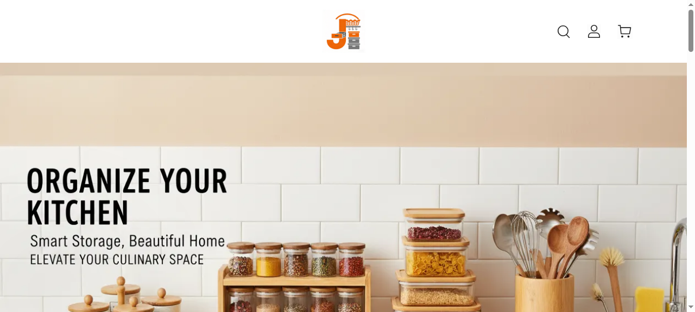

# Linbxx — Home Goods Storefront

A warm, editorial storefront for kitchen organisation — glass jars, spice racks and wooden tools — built to be browsed on a phone.

**[→ View the live site](https://linbxx.vercel.app/)**



## What this is

A home-goods shop where the product photography does the selling. The layout is deliberately quiet: warm neutrals, generous whitespace and a product grid that stays readable on a small screen.

The brief was simple — sell home goods to people browsing on a phone. So the whole build is mobile-first, with collection pages that load fast and a checkout path that doesn't lose people between "add to cart" and "pay".

## What's inside

- Full product grid with category browsing
- Collection pages
- Mobile-first checkout flow
- Self-contained static build — no external dependencies

## Technology

- HTML, CSS and JavaScript
- Static site — no build step required
- Deployed on Vercel and GitHub Pages

## Run it locally

No build step, no dependencies — it's plain HTML, CSS and JavaScript.

```bash
# from the repository root
python3 -m http.server 8000
# then open http://localhost:8000
```

Or just open `index.html` directly in a browser.


---

<sub>Built by **[Benito K Chukwuemeka](https://github.com/Ebubechineka)** · [Golden Vista Global](https://goldenvistaglobal.vercel.app/) — business websites, landing pages and web apps for clients in Nigeria and worldwide.</sub>
